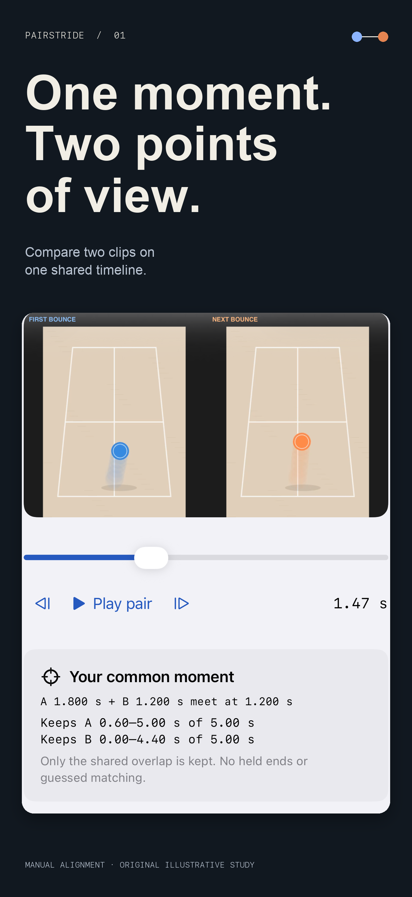

# Pairstride: Compare Videos

**Unsubmitted recovery work — October21,2026:** Replacement exports now preserve the previous checked movie and facts until a new result is verified. Native selected suites passed11/11 on iOS17 and26.5, including cancellation recovery and two successive example exports. This is private-source functional work; no new binary submission, approval or4.3 resolution. Premium campaign pixels unchanged.
A native iPhone and iPad utility for manually aligning two local clips at one shared event, viewing the common overlap and exporting a labeled comparison.

**Current status — October 20, 2026:** App 1.0 (1) rejected under Guideline 4.3(a) on October 20, 2026; Lifetime Pro Ready for Review. Recovery in progress; no new binary resubmission, approval or release. Submitted V1 receipt remains historical; the new source correction is unsubmitted. TestFlight remains skipped. The original 00:36 PDT submission receipt is historical. First app-specific clarification sent October20,2026; concrete Apple feedback pending. This is not a binary resubmission.

SwiftUI · AVFoundation · Core Image/Core Text · PhotosUI · StoreKit 2 · iOS 15+

The full basic two-clip/720p side-by-side workflow is free. Optional Lifetime Pro adds durable local projects, stacked layout, 1080p and reusable presets. No developer backend, tracking, ads or external AI. Commercial source stays private.

Engineering: one timeline/rendering path for preview and export; bounded media import; explicit retained ranges; original-file integrity checks; decoded event/audio checks; owned project copies with corruption detection and recoverable Trash; verified StoreKit entitlement and restore handling. Production QA and release checks are documented privately; this showcase is not a test or release receipt.

[Product and support](https://sepidehdalir.github.io/pairstride/) · [Privacy](https://sepidehdalir.github.io/pairstride/privacy.html) · [Portfolio](https://github.com/sepidehdalir/ios-app-portfolio)

Sepideh Javanbakht Dalir · [arvinify.com](https://www.arvinify.com) · hello@arvinify.com

## Product campaign

[All five iPhone frames](assets/) · [Dedicated iPad layout](assets/ipad-01.png). Screens show authentic native app UI and an original illustrative video study, not measured customer footage.
